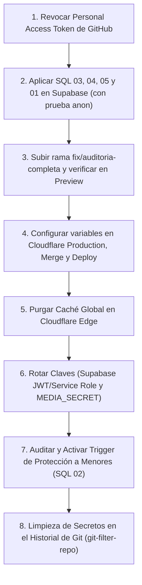

# GUÍA DE PASOS MANUALES OBLIGATORIOS (POST-AUDITORÍA)
**Proyecto:** Velvet Hub / Morbohub  
**Fecha de Auditoría:** 15 de Noviembre de 2026  
**Objetivo:** Secuencia ordenada estricta y sin tiempo de inactividad (Zero-Downtime) para aplicar configuraciones externas, migraciones de base de datos, despliegues y rotación de credenciales.

> [!IMPORTANT]
> Para no interrumpir el servicio ni dejar el sitio caído para los usuarios activos, sigue los pasos en el **orden numérico exacto** descrito a continuación.

---

## SECUENCIA DE EJECUCIÓN ZERO-DOWNTIME



---

### PASO 1: Revocar Token Personal de GitHub
Debido a que un token personal de GitHub (`github_pat_*`) estuvo expuesto en los scripts de sincronización antes de la auditoría:
1. Inicia sesión en **[GitHub](https://github.com/settings/tokens)**.
2. Ve a **Settings** > **Developer settings** > **Personal access tokens** > **Fine-grained tokens** (o **Tokens (classic)**).
3. Localiza el token comprometido y haz clic en **Revoke** / **Delete**.
4. Si requieres acceso CLI automatizado para scrapers o backups, genera un nuevo token con permisos mínimos estrictos (solo lectura sobre el repositorio específico) y almacénalo exclusivamente en un gestor de secretos o variable de entorno de tu máquina local.

---

### PASO 2: Aplicar Migraciones SQL en Supabase (03, 04, 05 y 01)
Abre el **SQL Editor** en el panel de control de Supabase (`https://supabase.com/dashboard/project/_/sql`). Ejecuta estos scripts en el orden indicado:

#### A. `sql/03_data_integrity_audit.sql` (Auditoría de solo lectura)
- **Ejecución:** Copia y corre el script.
- **Propósito:** Audita el estado actual sin modificar datos: detecta discrepancias en `page_count`, portadas vacías y duplicados.

#### B. `sql/04_indexes.sql` (Índices concurrentes de alto rendimiento)
- **Ejecución:** Copia y corre el script.
- **Propósito:** Crea índices parciales `CONCURRENTLY` sobre `(media_type, id DESC)`, tags GIN y búsqueda trigrama.
- **Garantía:** `CONCURRENTLY` previene cualquier bloqueo de tablas en producción.

#### C. `sql/05_thumbnails_lqip.sql` (Miniaturas LQIP no bloqueantes)
- **Ejecución:** Copia y corre el script.
- **Propósito:** Añade las columnas `thumb_color` y `thumb_lqip` con `DEFAULT NULL` (operación instantánea O(1) sin downtime).

#### D. `sql/01_rls_policies.sql` (Políticas de Row Level Security y permisos de anon)
- **Ejecución:** Copia y corre el script.
- **Propósito:** 
  - Revoca el acceso a la columna `url` original para el rol `anon`.
  - Habilita RLS en `items`, `profiles`, `favorites`, `invite_keys` y `source_aliases`.
  - Configura la vista de seguridad `public.catalog` con `cover_url`, `thumb_color` y `thumb_lqip` (sin dependencias de `auth.uid()`).
  - Ejecuta el bloque de pruebas automáticas:
    ```sql
    SET LOCAL ROLE anon;
    PERFORM id, title, cover_url, media_type FROM public.items LIMIT 1;
    PERFORM id, title, cover_url, media_type, source_label FROM public.catalog LIMIT 1;
    RESET ROLE;
    ```
  - Confirma que la consola de Supabase muestre:  
    `NOTICE: RLS OK: El rol anon solo puede leer metadatos públicos.`

---

### PASO 3: Subir Rama y Probar en Preview con Claves Actuales
Antes de tocar el entorno de producción, verifica la rama en un entorno aislado de Preview en Cloudflare Pages:

1. Sube la rama de trabajo:
   ```bash
   git push origin fix/auditoria-completa
   ```
2. Cloudflare Pages generará una URL de Preview (ejemplo: `https://<hash>.morbohub.pages.dev`).
3. Comprueba en la vista previa:
   - Navegación al catálogo (`/`): la página 1 y la página 2 cargan el número completo de cómics sin duplicados ni cortes.
   - Detalle de cómic: el visor carga imágenes a través de `/api/media?t=...` sin errores de token.
   - Detalle de video: el reproductor HLS carga video sin violaciones CSP.
   - Consola del navegador (F12): CERO advertencias de Content Security Policy (CSP).

---

### PASO 4: Cargar Variables en Production, Merge y Deploy
1. Inicia sesión en **[Cloudflare Dashboard](https://dash.cloudflare.com/)**.
2. Ve a **Workers & Pages** > Proyecto **`morbohub`** > **Settings** > **Environment variables**.
3. En la pestaña **Production**, configura las variables (utilizando aún las claves de Supabase actuales para permitir el cambio transparente de código antes de la rotación):
   - `SUPABASE_URL`: `https://qnmcejlxoufheisgkuyo.supabase.co`
   - `SUPABASE_ANON_KEY`: *(clave anon actual de Supabase)*
   - `SUPABASE_SERVICE_ROLE_KEY`: *(clave service_role actual; configurar como Secret/Encrypt)*
   - `MEDIA_SECRET`: Genera una cadena aleatoria de 64 caracteres hex:
     ```bash
     node -e "console.log(crypto.randomBytes(32).toString('hex'))"
     ```
     Configúrala como **Secret (Encrypt)**.
   - `POSTGREST_COUNT_MODE`: `count=estimated` (o dejar vacío para default).
4. Verifica los ajustes de Build en Cloudflare Pages:
   - **Framework preset:** `None`
   - **Build command:** *(vacío)*
   - **Build output directory:** `public`
   - **Compatibility flags:** `nodejs_compat`
5. Realiza el merge de la rama `fix/auditoria-completa` a tu rama de producción (`main` o `master`) o despliega por CLI:
   ```bash
   cd VERSION_CLOUDFLARE
   npx wrangler pages deploy public --project-name=morbohub
   ```

---

### PASO 5: Purgar Caché de Borde en Cloudflare
Para asegurar que ningún navegador o proxy intermedio retenga respuestas antiguas o cachés desalineadas:

1. En el Dashboard de Cloudflare, ve a **Caching** > **Configuration**.
2. Haz clic en **Purge Everything** y confirma la acción.
3. Abre en una ventana de incógnito:  
   `https://morbohub.pages.dev/api/version`  
   Verifica que devuelva:
   ```json
   {
     "version": "3.1.0",
     "cache_version": "v11-velvet-turbo",
     "commit": "fix/auditoria-completa",
     "engine": "Cloudflare-Pages-Functions"
   }
   ```

---

### PASO 6: Rotar Claves y Actualizar Variables Inmediatamente
Ahora que la nueva versión del código está activa en producción y utiliza Web Crypto HMAC, rota las credenciales en Supabase para invalidar cualquier rastro antiguo:

1. Ve a **[Supabase Dashboard](https://supabase.com/dashboard)** > Tu Proyecto > **Project Settings** > **API**.
2. En la sección **JWT Settings**:
   - Haz clic en **Generate new secret** (o ingresa un nuevo secreto de 64 caracteres).
   - Haz clic en **Apply changes**.
   *(Esto revoca de inmediato todas las claves JWT anteriores).*
3. Copia la nueva **anon key** y la nueva **service_role key**.
4. Regresa inmediatamente a **Cloudflare Pages** > **morbohub** > **Settings** > **Environment variables**:
   - Actualiza `SUPABASE_ANON_KEY` con la nueva clave anon.
   - Actualiza `SUPABASE_SERVICE_ROLE_KEY` con la nueva clave service_role.
   - Haz clic en **Save**.
5. Realiza un re-despliegue rápido en Cloudflare Pages (Deployments > Retry deployment o `npx wrangler pages deploy public`) para que las nuevas funciones tomen las variables actualizadas.

---

### PASO 7: Auditar y Activar Trigger de Protección a Menores
1. Abre el **SQL Editor** en Supabase y ejecuta primero:
   `sql/02_minor_protection_audit.sql`
   - Este script es de **solo lectura**.
   - Ejecuta las pruebas unitarias de leetspeak corrigiendo el mapeo (`$` -> `s`, `!` -> `i`, `0` -> `o`).
   - Revisa la lista de ítems devuelta por la consulta de auditoría.
2. Una vez confirmadas las coincidencias legítimas, ejecuta:
   `sql/02_minor_protection_trigger.sql`
   - Instala el trigger `items_before_write` en la tabla `public.items`.
   - Bloquea preventivamente (`status = 'blocked'`) cualquier elemento histórico coincidente.
   - A partir de este momento, cualquier intento de inserción o actualización de contenido prohibido será forzado a `status = 'blocked'`.

---

### PASO 8: Limpiar Historial de Git con git-filter-repo
Para eliminar definitivamente los secretos de los commits antiguos (`f7cac1f`, `eb4af5a`, `75d2262`, `340cc8e`):

1. Realiza una copia de seguridad local del repositorio:
   ```powershell
   Copy-Item -Recurse VERSION_CLOUDFLARE VERSION_CLOUDFLARE_BACKUP
   ```
2. Instala `git-filter-repo`:
   ```powershell
   pip install git-filter-repo
   ```
3. Crea un archivo `expressions.txt` con los patrones a sustituir:
   ```text
   regex:eyJhbGciOiJIUzI1NiIsInR5cCI6IkpXVCJ9\.[A-Za-z0-9-_]+\.[A-Za-z0-9-_]+==>REDACTED_JWT_TOKEN
   regex:github_pat_[A-Za-z0-9_]+==>REDACTED_GITHUB_TOKEN
   ```
4. Ejecuta el reemplazo en el repositorio:
   ```powershell
   git filter-repo --replace-text expressions.txt --force
   ```
5. Si deseas eliminar archivos sensibles del historial (ejemplo: `.env`, `.env.local`):
   ```powershell
   git filter-repo --invert-paths --path .env --path .env.local --force
   ```
6. Sube los cambios al remoto:
   ```powershell
   git remote add origin <URL_DEL_REPOSITORIO>
   git push origin fix/auditoria-completa --force
   ```

---
*Fin de la guía de pasos manuales post-auditoría.*
